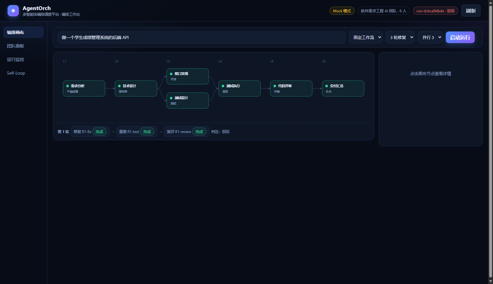
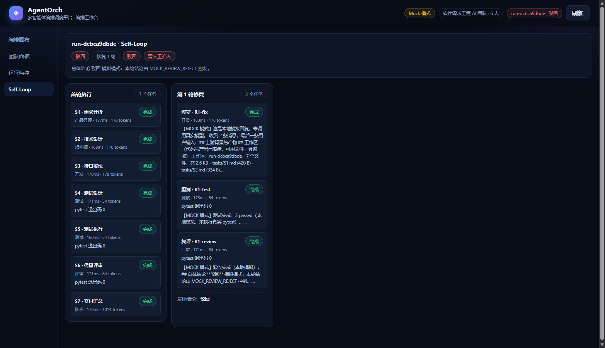

# AgentOrch · 多智能体编排调度平台

> 赛题一「Agent 编排创新应用」参赛项目。
> 当前进度：**Sprint 0（骨架 + 大模型链路）** + **模块 1（Agent 定义与配置）** + **模块 2（工作流编排）** + **模块 3（任务调度与执行）** + **模块 4（结果验证与监控）** + **模块 5（Self-Loop）** 已完成。

第一阶段把 FastAPI 分层骨架与 DeepSeek 调用链路跑通；模块 1 定义了 6 个固定角色、
写死工具权限，并用一份 JSON 描述团队；模块 2 用 `WorkflowStep` + 固定模板把标准流程
固化下来，按拓扑层并行执行；模块 3 负责任务状态机、内存任务列表、依赖派发与 Agent 调用；
模块 4 提供执行日志、测试执行、评审验收，并在测试失败/验收驳回时自动进入 Self-Loop。


---

## 当前已实现

| 能力 | 说明 |
| --- | --- |
| FastAPI 分层骨架 | `api / core / llm / agents / web`，配置、日志、异常统一出口 |
| DeepSeek 客户端 | 基于 OpenAI 兼容协议封装：普通调用、SSE 流式、JSON 模式、推理模型 |
| 错误归一化 | 鉴权失败、限流、超时、网络不可达、上游 5xx 全部映射为业务错误码 |
| 6 个内置 Agent | 队长 / 产品经理 / 架构师 / 开发 / 测试 / 评审，各自独立 system prompt |
| 工具权限 | 每个角色写死 `allowed_tools`，import 时校验，越权抛 403 |
| 团队配置 | `teams/software_team.json`：定义队长与成员映射，启动时装配并校验 |
| 单 Agent 试跑 | `POST /agents/{id}/run` 与 CLI，验证「prompt + 调 API」链路 |
| 任务调度器 | 任务清单 + 依赖检查（含环检测）+ 拓扑排序 + 顺序执行 |
| 队长自动拆解 | 一句 goal → 队长输出 DAG → 解析校验 → 顺序执行 |
| 双维度状态 | 执行状态（调度器）与验收结论（评审 Agent）分离，汇总为 `completed` / `rejected` |
| 工作区落盘 | 每个 run 独立 `data/workspaces/<run_id>/`，代码与产出可打开、可追溯 |
| 文件工具 | `file_list` / `file_read` / `file_write`，Agent 按权限调用，交接只给清单 |
| Self-Loop | 测试失败/评审驳回 → 修复 → 重测 → 复评，默认最多 3 轮，超限转人工 |
| 固定工作流 | `WorkflowStep`（step_name + agent + depends_on）+ 软件工程模板 |
| 分层并行 | 拓扑分层，层内 `asyncio.gather` 并发，信号量限流 |
| 执行日志 | 每个 run 维护内存 `logs`，记录任务开始/完成/失败、并行层、Self-Loop、验收结论 |
| 测试执行 | `test_runner` 工具在工作区真跑 `pytest`，返回退出码与输出 |
| 运行记录 | 内存存储任务状态、耗时、token 与输出，支持运行详情查询 |
| 失败传播 | 上游失败 → 下游 `skipped`，无关任务继续执行 |
| 离线 Mock | `LLM_MOCK=true` 时不发真实请求，单测与前端联调无需 Key |
| 编排工作台 | `http://127.0.0.1:8000/`，画布 / 团队 / 运行时间线 / Self-Loop 四个视图 |
| 单元测试 | 83 个用例，覆盖链路、角色、团队校验、依赖检查、调度状态机、拆解、工作区、Self-Loop、并行工作流与日志 |


## 前端工作台

零构建单页（原生 JS + SVG），由 FastAPI 直接托管在 `/`，不需要 npm 或打包：

- **编排画布**：固定工作流用模板图，队长拆解用本次 run 的任务图；修复轮会显示 `R<n>-fix → R<n>-test → R<n>-review` 修复链
- **团队面板**：6 个 Agent 的角色、工具（占位工具虚化）与完整 system prompt
- **运行监控**：运行列表、任务表（耗时 / token / pytest 退出码 / 可点击的交付文件）、执行时间线、验收阻断项
- **Self-Loop**：首轮任务 + 每轮 `R<n>-fix` / `R<n>-test` / `R<n>-review` 三张卡，显示复评结论与是否转人工
- 两种入口：固定工作流 / 队长拆解；运行中每 1.2 秒轮询，结束后自动停止轮询
- 交付文件点开走 `GET /runs/{run_id}/file`，在工作区里安全读取（阻止路径穿越）




其他截图：[运行监控](docs/ui-runs.png) · [团队面板](docs/ui-team.png)

## 模块 1：Agent 定义与配置

### 6 个内置角色

角色是**固定写死**的 6 个类，不做动态注册；每个类的核心就是一段 system prompt。

| Agent id | 角色 | 职责 | 工具权限 |
| --- | --- | --- | --- |
| `captain` | 队长 | 拆解任务 DAG、按依赖调度、汇总验收 | `task_plan` `task_dispatch` `knowledge_search` |
| `product_manager` | 产品经理 | 需求规格、接口定义、数据字段、验收标准 | `knowledge_search` `web_search` `file_write` |
| `architect` | 架构师 | 技术方案、模块划分、表结构、接口契约 | `knowledge_search` `file_read` `file_write` |
| `developer` | 开发 | 按设计编码，按失败日志修复 | `file_read` `file_write` `python_exec` `shell_exec` |
| `tester` | 测试 | 生成并运行 pytest，输出测试报告 | `file_read` `file_write` `python_exec` `test_runner` |
| `reviewer` | 评审 | 独立验收、证据化结论、安全检查 | `file_read` `knowledge_search` `test_runner` |

队长不持有任何代码执行工具（`shell_exec` / `python_exec`），与执行成员完全隔离；
评审不持有写权限，只能读代码、跑测试、给结论。

工具注册表里有 10 个名字，但只有 6 个真正实现并暴露给模型：`file_list` / `file_read` /
`file_write` / `test_runner` / `python_exec` / `knowledge_search`。
`task_plan` / `task_dispatch` 属于编排层内部能力，`web_search` / `shell_exec` 尚未开放——
这四个在 `/api/v1/agents/tools` 里明确标 `implemented=false`，不会伪装成可用工具。

### 团队 JSON

团队配置只决定「队长是谁、有哪些成员」，不承载 prompt：

```json
{
  "id": "software_team",
  "name": "软件需求工程 AI 团队",
  "captain": "captain",
  "members": [
    { "id": "captain", "role": "captain" },
    { "id": "product_manager", "role": "product_manager" },
    { "id": "architect", "role": "architect" },
    { "id": "developer", "role": "developer" },
    { "id": "tester", "role": "tester" },
    { "id": "reviewer", "role": "reviewer" }
  ]
}
```

启动时装配并校验：成员 id 唯一、角色必须存在、队长必须在成员列表里且角色为 `captain`，
配置错误直接启动失败，避免带病运行。成员支持可选 `name` 覆盖显示名。

### 单独试跑一个 Agent

```powershell
cd AgentOrch\backend

# 查看团队成员与工具权限
.\.venv\Scripts\python.exe scripts\run_agent.py --list

# 队长拆解任务
.\.venv\Scripts\python.exe scripts\run_agent.py --agent captain --task "做一个学生成绩管理系统的后端 API"

# 架构师基于需求文档做设计
.\.venv\Scripts\python.exe scripts\run_agent.py --agent architect --task "设计表结构与接口" --context "需求文档内容……"

# 无 Key 时加 --mock
.\.venv\Scripts\python.exe scripts\run_agent.py --agent captain --task "演示" --mock
```

也可以走 HTTP：

```powershell
curl.exe -X POST http://127.0.0.1:8000/api/v1/agents/captain/run `
  -H "Content-Type: application/json" `
  -d "{\"task\":\"做一个学生成绩管理系统的后端 API\"}"
```

响应包含 `content`、`model`、`usage`、`latency_ms`、`allowed_tools`，便于后续调度与审计。

## 模块 2：工作流编排

### 数据结构

```python
class WorkflowStep(BaseModel):
    step_name: str
    agent: str
    depends_on: list[str] = []
```

一个工作流模板就是一组 `WorkflowStep`。内置模板 `software_development`：

| 层 | 步骤 | 负责 Agent | 依赖 |
| --- | --- | --- | --- |
| L1 | 需求分析 | product_manager | — |
| L2 | 技术设计 | architect | 需求分析 |
| L3 | **接口实现** | developer | 技术设计 |
| L3 | **测试设计** | tester | 技术设计 |
| L4 | 测试执行 | tester | 接口实现、测试设计 |
| L5 | 代码评审 | reviewer | 测试执行 |
| L6 | 交付汇总 | captain | 代码评审 |

L3 的两个步骤没有相互依赖，会并行执行。

### 拓扑分层

Kahn 算法按层输出（同一层内互不依赖），层与层之间是屏障。校验覆盖：
步骤名重复、未知 Agent、悬空依赖、依赖自己、环（报 `workflow_cycle`）。

### 分层并行执行

- 每一波扫描所有 pending 任务，依赖全部 `completed` 的进入就绪集合；
- 层内用 `asyncio.gather` 并发，`Semaphore(max_parallel)` 限流（默认 3）；
- 上游失败的任务直接 `skipped`，不阻塞同层无关任务；
- Self-Loop 的修复链（`R<n>-fix` → `R<n>-test` → `R<n>-review`）保持串行。

### 接口

```powershell
# 模板列表 / 详情
curl.exe http://127.0.0.1:8000/api/v1/workflows
curl.exe http://127.0.0.1:8000/api/v1/workflows/software_development

# 按模板发起运行（默认异步，wait=true 同步等结果）
curl.exe -X POST "http://127.0.0.1:8000/api/v1/workflows/software_development/runs?wait=true" `
  -H "Content-Type: application/json" `
  -d "{\"goal\":\"做一个最小 FastAPI 服务\",\"max_parallel\":2,\"max_repair_rounds\":0}"
```

响应里 `workflow=software_development`、`plan_source=workflow`；
步骤名是中文，落盘任务 id 自动映射为 `S1…S7`，依赖关系同步映射。

实测：7 个任务按 6 层执行，L3 的 S3 / S4 在同一秒启动（19:22:49），等最慢的 S4
结束后才进入 S5，全链路 154s。评审最终驳回（缺 pytest 执行证据），
`max_repair_rounds=0` → `status=rejected`、`execution_status=completed`、`needs_human=true`，
正好验证了「执行完成但验收不通过」的降级路径。

## 模块 3：任务调度与执行

调度链路支持两种入口：

- **队长自动拆解**：`POST /runs {"goal": "..."}`，队长先产出任务 DAG，解析校验后直接顺序执行；
- **手动任务清单**：`POST /runs {"tasks": [...]}`，跳过拆解，直接执行给定清单。

拆解与执行之间可以插入人工确认：`POST /runs/plan` 只出计划不执行。

```json
{
  "goal": "做一个学生成绩管理系统的后端 API",
  "tasks": [
    { "id": "T1", "title": "需求规格", "owner": "product_manager", "goal": "写需求文档" },
    { "id": "T2", "title": "技术设计", "owner": "architect", "goal": "写设计文档", "depends_on": ["T1"] },
    { "id": "T3", "title": "编码实现", "owner": "developer", "goal": "实现接口", "depends_on": ["T2"] }
  ]
}
```

### 队长拆解（goal → 任务清单）

- 调用队长 Agent，要求输出「说明 + json 代码块形式的任务 DAG」；
- [planner.py](backend/app/orchestration/planner.py) 从输出里提取 JSON，兼容围栏和非围栏两种写法；
- 逐个任务按 `TaskSpec` 校验，再交给调度器做依赖检查与拓扑排序；
- 解析失败返回 422（`plan_parse_failed`），不会创建空 run；
- `plan_source` 字段标明这次是 `captain` 拆的还是 `manual` 传入的。

### 依赖检查（执行前）

- 任务 id 唯一、负责人必须在当前团队中
- 依赖必须存在、不能依赖自己、不能重复声明
- Kahn 拓扑排序检测环，有环直接 400（`task_cycle`）
- 单次运行任务数上限 20

`POST /api/v1/runs/validate` 只校验不执行，返回拓扑序，便于前端画图或人工确认。

### 任务列表与状态机

- 任务列表存在 Python 内存里（`RunState.tasks` + `RunStore` 的 dict），不依赖 Redis；
  进程重启即丢，属于明确取舍
- 任务状态：`pending → running → completed` 三态为主，失败和上游未成功用 `failed / skipped`
  补充，便于 Self-Loop 识别可修复任务
- 依赖派发：每个任务只有在前序全部 `completed` 时才进入就绪集合；
  任一前序 `failed / skipped`，该任务直接 `skipped`，无关任务继续执行
- 每个 Agent 任务就是一次 `agent.run()`：system prompt + 任务描述 + 工作区清单，
  内部调用一次 DeepSeek API（测试/评审可能多轮工具调用）

### 顺序执行

- 按拓扑序逐个执行，同一时刻只有一个任务在跑，同层任务也不会并行
- 代码与产出落盘到运行工作区，下游 `context` 只有工作区清单（文件名 + 大小），不再贴全文
- Agent 通过 `file_list` / `file_read` / `file_write` 工具按需读写文件
- 任务失败：下游标记 `skipped`，无关任务继续执行；整个 run 最终为 `failed`
- 每个任务记录状态、耗时、token 用量、模型、产出文件与错误信息
- `POST /api/v1/runs` 默认异步执行（返回 202 + run_id），加 `?wait=true` 则等执行完返回

状态机：任务 `pending → running → completed / failed / skipped`；
运行 `pending → running → completed / rejected / failed`。

### 真实运行示例

**手动清单**：3 个任务（产品经理 → 架构师 → 开发）顺序执行，22.2s、6945 tokens，
架构师引用了上游的 AC1，开发沿用了架构师定的三张表。

**队长自动拆解**：一句需求拆出 6 个任务（产品经理 → 架构师 → 开发 ×2 → 测试 → 评审），
队长 4.6s 出计划，全链路 125s、约 39k tokens，6/6 执行完成。
这次运行也暴露了一个真实问题：开发产出被上下文截断，测试和评审都据此判了「不完整」——
**执行完成 ≠ 验收通过**，这正是下一步 Self-Loop 要接的口子。

```powershell
# 只拆解，不执行
curl.exe -X POST http://127.0.0.1:8000/api/v1/runs/plan `
  -H "Content-Type: application/json" `
  -d "{\"goal\":\"做一个学生成绩管理系统的后端 API\"}"

# 一句话需求直接跑完
curl.exe -X POST "http://127.0.0.1:8000/api/v1/runs?wait=true" `
  -H "Content-Type: application/json" `
  -d "{\"goal\":\"做一个学生成绩管理系统的后端 API\"}"
```

也可以直接用 CLI 看拆解结果和执行进度：

```powershell
cd AgentOrch\backend

# 拆解 + 顺序执行
.\.venv\Scripts\python.exe scripts\run_pipeline.py --goal "做一个学生成绩管理系统的后端 API"

# 只看队长拆出什么，不执行
.\.venv\Scripts\python.exe scripts\run_pipeline.py --goal "..." --plan-only

# 离线跑通全流程
.\.venv\Scripts\python.exe scripts\run_pipeline.py --goal "..." --mock
```

已知限制：运行记录存在内存里，进程重启即丢失；并发、重试、断点续跑留给下一阶段。

## 模块 4：结果验证与监控

### 执行 ≠ 验收

一次 run 同时维护两个正交维度：

| 字段 | 取值 | 谁负责 |
| --- | --- | --- |
| `execution_status` | `pending / running / completed / failed` | 调度器（有没有异常） |
| `acceptance.status` | `pending / passed / rejected / needs_revision` | 评审 Agent（内容合不合格） |
| `status` | `completed / rejected / needs_revision / failed / running` | 汇总 |

评审输出里的「总体结论」被解析成验收结论：`通过` / `有条件通过` → `passed`，
`驳回` → `rejected`。执行全部完成但评审驳回时，`status=rejected`、`execution_status=completed`，
两个维度不会互相覆盖。

**验收缺失探针**：只要有评审任务、却没解析出「总体结论」，就判
`acceptance.status=needs_revision`、`status=needs_revision`、`needs_human=true`，
绝不放行成 `completed`。评审偶尔会漏写小标题，这一条是兜底。

### 执行日志

每个 run 在内存里维护 `logs`（`LogLevel` + 时间 + `task_id`），记录：
运行开始、任务开始/完成/失败/跳过、并行层启动、Self-Loop 轮次、验收结论、运行结束。

```powershell
curl.exe http://127.0.0.1:8000/api/v1/runs/{run_id}/logs
```

上限 200 条，跟着运行记录一起存在内存里，进程重启即丢——和任务列表的存储策略一致，不引入 Redis。

每个任务还会留存 `tool_calls`：工具名、参数摘要、结果摘要、是否成功；`test_runner` 的退出码
另外写进 `test_result`，避免「工具到底调没调」只能靠猜。

### 测试执行

`test_runner` 工具在工作区根目录执行 `python -m pytest -q`（180s 超时），
返回退出码与测试输出（截断到 12000 字符）。测试 Agent 和评审 Agent 有权限使用；
`__pycache__`、`.pytest_cache` 会从工作区清单里过滤，不污染交接内容。

实测：在一个 12 个用例的交付工作区里，测试 Agent 调用 `test_runner` 实际执行 pytest，
工作区生成 `.pytest_cache`，报告 `12 passed`。

完整的可验证清单见 [docs/verification.md](docs/verification.md)（含「故意制造失败」的降级测试）。

实测：一句需求拆 5 个任务，下游 context 只有 47–480 字符，工作区落盘 14 个真实文件，
评审「有条件通过」被正确解析为 `passed`，run 状态 `completed`。

## 模块 5：Self-Loop 自我循环

### 触发条件（任一即可）

1. **测试门**：测试 Agent 调用 `test_runner` 后 pytest 退出码非 0——即使评审给了「通过」，
   也强制判为 `rejected`；
2. **评审驳回**：评审「总体结论」为 `驳回`。

评审存在但没给结论（`needs_revision`）不进入循环——信息不足不是「可修复」的问题，直接转人工。

### 一轮循环做什么

```
R<n>-fix（开发：读失败日志 + 评审记录，修代码）
   ↓
R<n>-test（测试：重新跑 pytest，退出码落库）
   ↓
R<n>-review（评审：重新验收）
```

- 修复任务的 goal 里直接带**失败测试日志**（末尾 3000 字）和评审结论，开发不用猜；
- 重测任务必须调用 `test_runner`，结果写回 `TaskState.test_result`；
- 测试退出码为 0 且复评通过，才 `status=completed`。

### 轮次与降级

`max_repair_rounds` 默认 **3**（上限 5）：

- 轮次用尽仍未通过 → `status=rejected`、`needs_human=true`，日志提示转人工；
- `max_repair_rounds=0` 可关闭循环，直接暴露首次失败结果。

### 关键代码

- [acceptance.py](backend/app/orchestration/acceptance.py)：评审结论解析 + 测试门
- [self_loop.py](backend/app/orchestration/self_loop.py)：生成修复/重测/复评任务
- [scheduler.py](backend/app/orchestration/scheduler.py)：轮次控制与测试结果取证

测试门、失败触发循环、轮次耗尽三条路径由 `tests/test_self_loop.py` 的 7 个用例确定性覆盖。

**真机失败链路**（2026-11-09）：手动构造一个首轮必失败的场景——要求工作区同时存在
`app/main.py`、`tests/test_health.py`、`docs/acceptance.md`，但开发者只被要求写
`app/main.py`。评审首轮给出「驳回」（并因无测试用例导致 pytest 退出码 5），
系统自动追加 `R1-fix` / `R1-test` / `R1-review`：

```
T1  开发   completed  → app/main.py
T2  评审   completed  → 驳回（缺 tests/、docs/；pytest 退出码 5）
Self-Loop 第 1 轮：追加 3 个任务（R1-fix, R1-test, R1-review）
R1-fix  开发 completed → 补齐 tests/test_health.py、docs/acceptance.md
R1-test 测试 completed → pytest 退出码 0
R1-review 评审 completed → 总体结论：通过
最终 status=completed, rounds=1, 84s
```

这条链路里的工具调用全部留痕（`file_read` / `file_write` / `test_runner` / `python_exec`）。

## 目录结构

```
AgentOrch/
├── backend/
│   ├── app/
│   │   ├── main.py              # 应用入口：lifespan、中间件、异常处理、静态页
│   │   ├── api/
│   │   │   ├── deps.py          # 依赖注入（LLM 客户端、团队）
│   │   │   ├── schemas.py       # Pydantic 请求/响应模型
│   │   │   └── v1/
│   │   │       ├── router.py    # 路由聚合，后续挂 workflows/tasks/runs
│   │   │       ├── system.py    # 健康检查、模型列表、LLM ping
│   │   │       ├── chat.py      # 普通对话 + SSE 流式对话
│   │   │       ├── agents.py    # 角色、工具、团队、单 Agent 试跑
│   │   │       ├── runs.py      # 依赖校验、创建运行、查询运行
│   │   │       └── workflows.py # 固定工作流模板与运行入口
│   │   ├── agents/
│   │   │   ├── base.py          # BaseAgent / AgentSpec / AgentRunResult
│   │   │   ├── tools.py         # 工具注册表与权限异常
│   │   │   ├── tooling.py       # 文件工具的 function-calling 定义
│   │   │   ├── registry.py      # 团队装配与配置校验
│   │   │   ├── teams/software_team.json
│   │   │   └── roles/           # 6 个角色类（prompt 都在这里）
│   │   ├── orchestration/
│   │   │   ├── models.py        # TaskSpec / TaskState / RunState / AcceptanceState
│   │   │   ├── planner.py       # 队长输出解析、任务校验
│   │   │   ├── scheduler.py     # 依赖校验、拓扑排序、顺序 / 分层并行执行
│   │   │   ├── workflow.py      # WorkflowStep、固定模板、拓扑分层
│   │   │   ├── acceptance.py    # 评审结论解析（通过 / 驳回）
│   │   │   ├── self_loop.py     # 驳回后追加修复与复评任务
│   │   │   ├── workspace.py     # 运行工作区：落盘、清单、文件工具执行
│   │   │   └── store.py         # 内存运行记录
│   │   ├── core/                # config / errors / logging
│   │   ├── llm/client.py        # DeepSeek 客户端封装（含 function calling 循环）
│   │   └── web/index.html       # 零构建联调台
│   ├── tests/                   # pytest
│   ├── scripts/
│   │   ├── smoke.py             # 端到端冒烟
│   │   ├── run_agent.py         # 单 Agent 试跑 CLI
│   │   └── run_pipeline.py      # 队长拆解 + 顺序执行 + Self-Loop CLI
│   ├── requirements.txt
│   ├── .env.example
│   └── run.py                   # python run.py
├── docs/
│   ├── console.png              # 联调台截图
│   └── verification.md          # 验收与 Self-Loop 验证清单
└── README.md
```

## 快速开始

```powershell
cd AgentOrch\backend

# 1. 创建虚拟环境并安装依赖（已创建过可跳过）
python -m venv .venv
.\.venv\Scripts\Activate.ps1
pip install -r requirements.txt

# 2. 配置密钥
Copy-Item .env.example .env
#   编辑 .env，填写 DEEPSEEK_API_KEY=sk-xxxx

# 3. 启动
python run.py
```

启动后：

- 联调台：<http://127.0.0.1:8000/>
- 接口文档：<http://127.0.0.1:8000/docs>
- 团队配置：<http://127.0.0.1:8000/api/v1/team>

### 无 Key 也能跑

```powershell
$env:LLM_MOCK="true"
python run.py
```

Mock 模式下所有接口照常返回（内容带 `【MOCK 模式】` 前缀），便于单测和前端联调。
Mock 不是一句空话：队长会返回可解析的任务 DAG，评审会返回带「总体结论：通过」的验收记录，
测试会返回一次假的 `test_runner` 调用（退出码 0）——离线也能跑出完整的
「拆解 → 执行 → 验收 → 工具留痕」链路。
想离线看 Self-Loop 的修复轮次，再设 `MOCK_REVIEW_REJECT=true`，评审会固定驳回，
系统跑满修复轮次后标记 `needs_human`。

## 接口一览

| 方法 | 路径 | 说明 |
| --- | --- | --- |
| GET | `/api/v1/health` | 服务状态与 LLM 配置状态 |
| GET | `/api/v1/llm/models` | 可选模型列表 |
| POST | `/api/v1/llm/ping` | 真实调用一次模型，验证连通性 |
| POST | `/api/v1/chat` | 对话，一次性返回 |
| POST | `/api/v1/chat/stream` | 对话，SSE 流式返回 |
| GET | `/api/v1/agents/roles` | 6 个内置角色及工具权限 |
| GET | `/api/v1/agents/tools` | 全部工具及说明 |
| GET | `/api/v1/team` | 当前团队配置与成员详情（含 prompt） |
| GET | `/api/v1/agents/{agent_id}` | 单个 Agent 配置 |
| POST | `/api/v1/agents/{agent_id}/run` | 试跑单个 Agent |
| POST | `/api/v1/runs/plan` | 队长拆解任务，只出计划不执行 |
| POST | `/api/v1/runs/validate` | 依赖检查，只返回拓扑序不执行 |
| POST | `/api/v1/runs` | 创建并执行（给 tasks 直接跑，只给 goal 先拆解） |
| GET | `/api/v1/runs` | 最近运行列表（摘要，不含输出） |
| GET | `/api/v1/runs/{run_id}` | 运行详情（含每个任务的输出与用量） |
| GET | `/api/v1/runs/{run_id}/logs` | 运行执行日志（内存） |
| GET | `/api/v1/workflows` | 内置工作流模板（含拓扑分层） |
| GET | `/api/v1/workflows/{workflow_id}` | 模板详情 |
| POST | `/api/v1/workflows/{workflow_id}/runs` | 按模板发起运行（分层并行） |

`POST /runs` 的 `max_repair_rounds` 控制验收/测试失败后的修复轮次（默认 3，0 表示不循环）。
Run 响应里除了任务列表，还包含 `execution_status`、`acceptance`、`rounds`、
`needs_human` 与 `workspace_dir`；固定工作流的运行还会带 `workflow`。

### 调用示例

```powershell
# 连通性探测
curl.exe -X POST http://127.0.0.1:8000/api/v1/llm/ping

# 普通对话
curl.exe -X POST http://127.0.0.1:8000/api/v1/chat `
  -H "Content-Type: application/json" `
  -d "{\"messages\":[{\"role\":\"user\",\"content\":\"用一句话介绍 AgentOrch\"}]}"

# 流式对话（SSE）
curl.exe -N -X POST http://127.0.0.1:8000/api/v1/chat/stream `
  -H "Content-Type: application/json" `
  -d "{\"messages\":[{\"role\":\"user\",\"content\":\"写一个 Python 快排\"}]}"
```

流式事件格式：

```
data: {"type":"delta","delta":"你"}
data: {"type":"delta","delta":"好"}
data: {"type":"done","finish_reason":"stop","latency_ms":1234,"usage":{...},"mode":"live"}
```

错误事件：`{"type":"error","code":"llm_timeout","message":"..."}`。

## 配置项（backend/.env）

| 变量 | 默认值 | 说明 |
| --- | --- | --- |
| `DEEPSEEK_API_KEY` | 空 | DeepSeek 密钥，为空且非 mock 时对话接口返回 503 |
| `DEEPSEEK_BASE_URL` | `https://api.deepseek.com` | 兼容任意 OpenAI 协议网关 |
| `DEEPSEEK_MODEL` | `deepseek-chat` | 默认模型 |
| `DEEPSEEK_REASONER_MODEL` | `deepseek-reasoner` | 推理模型（自动忽略 temperature） |
| `LLM_TEMPERATURE` | `0.7` | 默认温度 |
| `LLM_TIMEOUT` | `120` | 单次请求超时（秒） |
| `LLM_MAX_RETRIES` | `2` | SDK 层重试次数 |
| `LLM_MOCK` | `false` | 本地模拟开关 |
| `DEFAULT_TEAM` | `software_team` | 启动时装配的团队配置 id |
| `ENVIRONMENT` | `dev` | `dev` 时 uvicorn 开启热重载 |
| `PORT` | `8000` | 监听端口 |

## 测试

```powershell
cd AgentOrch\backend

# 单元测试（mock，不产生真实调用）
.\.venv\Scripts\python.exe -m pytest

# 端到端冒烟（需先启动服务，会真实调用模型）
.\.venv\Scripts\python.exe scripts\smoke.py
```

测试默认注入 `LLM_MOCK=true`，不会产生真实调用与费用。

> 小坑：若本机配置了系统代理，`httpx` 默认会走代理导致访问 127.0.0.1 返回 502，
> `scripts/smoke.py` 已固定 `trust_env=False`；自己写脚本时注意同样处理。

## 设计说明：为什么这样分层

- **LLM 客户端与业务解耦**：Agent、工作流只依赖 `DeepSeekClient` 的数据结构
  （`ChatResult` / `StreamChunk` / `Usage`），将来接多模型路由只改一个文件。
- **Prompt 就是配置**：每个角色一个类，prompt 作为类属性；改 prompt 只改一个文件，
  可 diff、可 review，不散落在数据库或 JSON 里。
- **权限在 import 阶段校验**：`BaseAgent.__init_subclass__` 检查工具是否注册、
  prompt 是否为空、温度是否合法；写错直接启动失败，不会带病运行。
- **错误先归一化再抛给 API**：`openai` 的异常类型不外泄，前端拿到稳定的
  `{code, message}`，便于调度引擎按错误类型决定重试 / 降级。
- **连接复用**：`AsyncOpenAI` 在 lifespan 中创建一次、全局共享，避免每请求建连。
- **Mock 是一等公民**：没有 Key 也能演示完整链路，评审复现成本低。
- **依赖先校验再执行**：调度器不信任输入，环、悬空依赖、未知负责人在建 run 前就拒绝，
  执行阶段不需要再处理这类错误。
- **失败只影响下游**：一个任务失败不会拖垮整张图，无关分支继续跑，
  失败原因写进 `TaskState.error`，便于 Self-Loop 后续生成修复任务。
- **拆解与执行解耦**：`/runs/plan` 只出计划，`/runs` 才执行；
  计划可以先人工看一眼，也可以直接 `plan_source=captain` 一路跑到底。
- **执行与验收解耦**：调度器只对「有没有跑完」负责，评审 Agent 才对「合不合格」负责；
  两个状态分开存，驳回时不会被 `completed` 掩盖。
- **交接靠文件，不靠 prompt**：代码落盘、下游拿清单按需读取，
  避免几万字的代码在上下文里被截断。
- **工具调用双层兼容**：优先标准 `tool_calls`；上游网关偶尔把调用写成 DSML 文本时，
  自动解析并执行，避免工具调用半途丢失。
- **固定模板与自由拆解并存**：自由拆解靠队长，适合开放需求；固定模板靠 `WorkflowStep`
  把标准流程固化下来，适合演示与回归。

## 下一步

1. **代码执行工具**：`python_exec` / `test_runner` 真正跑起来，让测试 Agent 能执行 pytest，而不只是写用例
2. **结构化验收**：把评审表格解析成「每条 AC 的通过情况」，修复任务只带失败项
3. **调度引擎升级**：`attempt_id` 原子认领、事件驱动派发、超时回收、SQLite 持久化
4. **实时推送**：WebSocket 事件总线，前端监控面板接入
5. **前端编排画布**：Vue 3 + AntV X6，拖拽生成工作流

> 详细设计见《AgentOrch_设计方案.docx》，验证步骤见 [docs/verification.md](docs/verification.md)。
